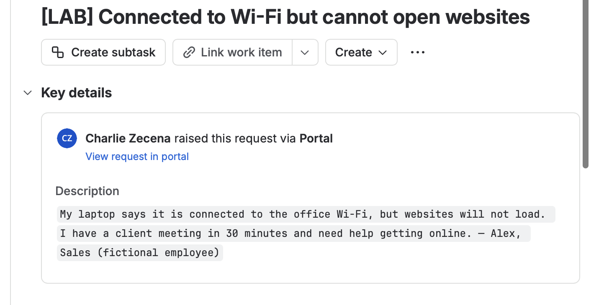
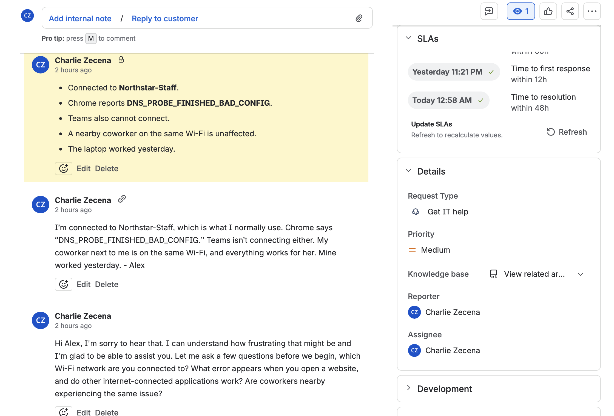
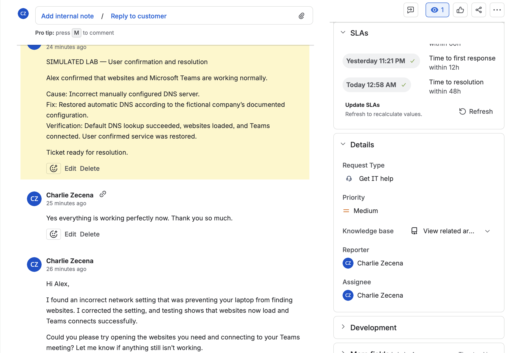
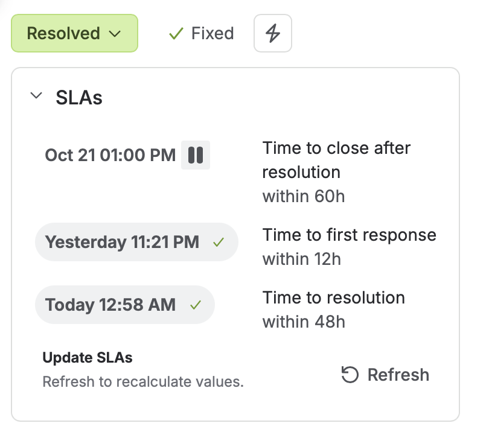

# Case 1: Connected to Wi-Fi but Unable to Browse Websites

**Ticket:** IT-1  
**Platform:** Jira Service Management  
**Status:** Resolved  
**Resolution:** Fixed  
**Scenario:** Simulated Windows 11 troubleshooting

## Reported Issue

Alex, a fictional Sales employee, reported that their laptop connected to office Wi-Fi but could not load websites or connect to Microsoft Teams. An upcoming client meeting made restoring access time-sensitive.

## Initial Investigation

I asked which Wi-Fi network Alex was using, whether other applications were affected, and whether coworkers experienced the same problem.

The simulated responses established that:
- The laptop was connected to the intended network, Northstar-Staff.
- Chrome displayed DNS_PROBE_FINISHED_BAD_CONFIG.
- Teams could not connect.
- A coworker on the same Wi-Fi could browse normally.

These findings suggested an issue affecting the individual laptop rather than a widespread outage.

## Diagnostic Evidence

All results below were provided as part of the simulated scenario.

| Check | Result | Interpretation |
|---|---|---|
| `ipconfig /all` | IP: 192.168.10.55; gateway: 192.168.10.1; DNS: manually configured as 192.168.50.10 | Identified the laptop’s network configuration for comparison |
| `ping 1.1.1.1` | Four replies received | Confirmed ICMP reachability to that IP address; did not verify DNS or web browsing |
| `nslookup example.com` | Timed out using 192.168.50.10 | The configured DNS server did not answer this lookup |
| Comparison with a working laptop and fictional company documentation | Automatic DNS configuration was expected; the working laptop used 192.168.10.10 | Showed that the affected laptop differed from the expected configuration |
| `nslookup example.com 192.168.10.10` | Lookup succeeded | Confirmed that the specified alternative DNS server could resolve the test domain |

## Identified Cause

Within the scenario, the laptop had an incorrect manually configured DNS server. It could reach the tested external IP address, but lookups through its configured DNS server timed out.

Manual DNS settings are not inherently incorrect. The conclusion was based on the lookup results and comparison with the fictional company’s expected configuration.

## Simulated Fix and Verification

The simulated fix restored automatic DNS settings, after which the laptop received DNS server 192.168.10.10.

Verification results in the scenario:
- A lookup using the default DNS configuration succeeded.
- Websites loaded successfully.
- Microsoft Teams connected.
- Alex confirmed that everything was working.

## Ticket Handling

I assigned the ticket to myself, communicated with the simulated customer, recorded internal troubleshooting and resolution notes, and obtained customer confirmation before marking the ticket Resolved with resolution Fixed.

## Lessons Learned

- Wi-Fi connectivity does not guarantee working website access.
- Successful ping replies verify reachability to the tested IP, not DNS functionality.
- Specifying a server in nslookup tests that server without changing the laptop’s saved DNS settings.
- Comparing an affected device with a working device helps narrow the investigation.
- Clear notes should connect the symptoms, evidence, corrective action, and verification.

## Scope and Limitations

The Jira ticket workflow was performed hands-on. The Windows diagnostic outputs, configuration changes, verification results, and customer responses were simulated. One account represented both the customer and agent in this first exercise.

## Screenshots

### 1. Original request

### 2. Initial investigation

### 3. Diagnosis and simulated fix

### 4. Customer confirmation

### 5. Resolved ticket

