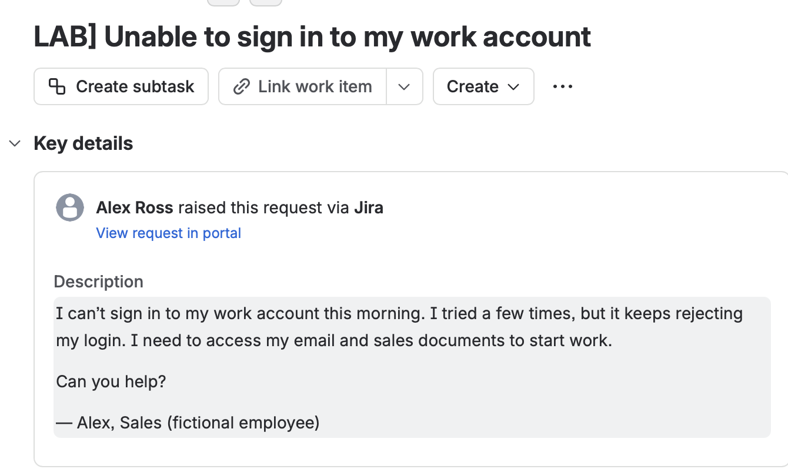
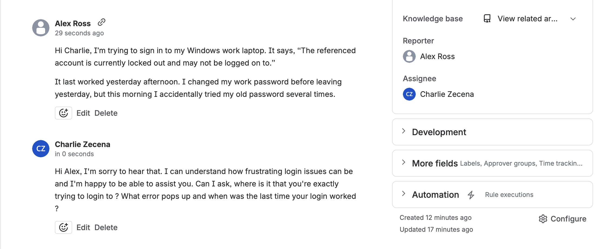
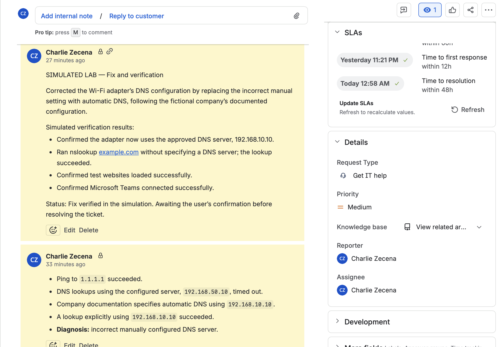
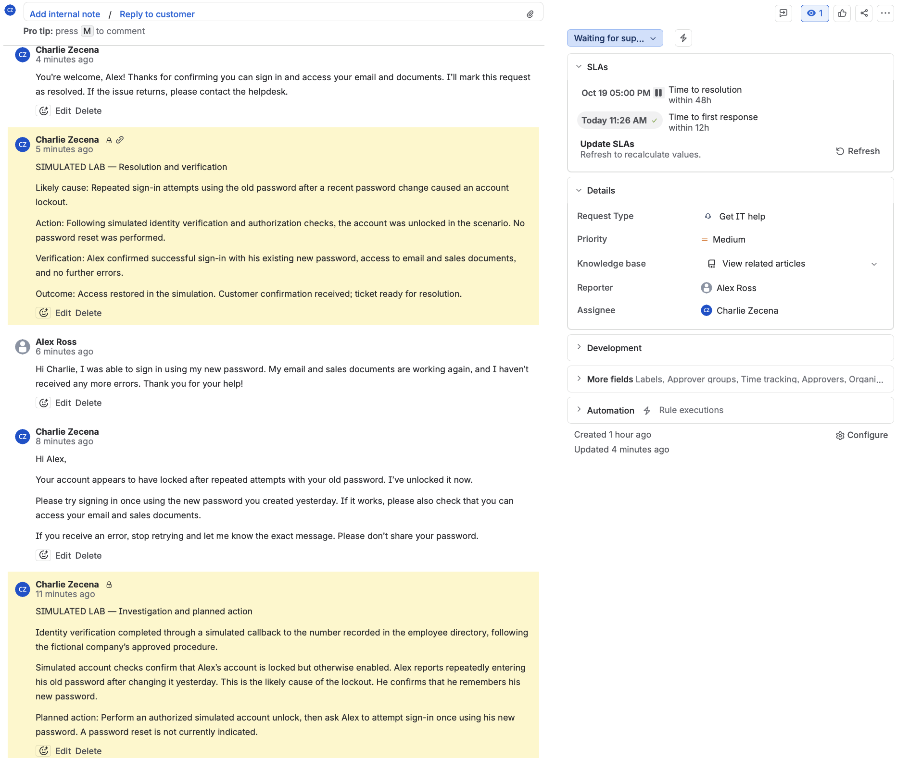
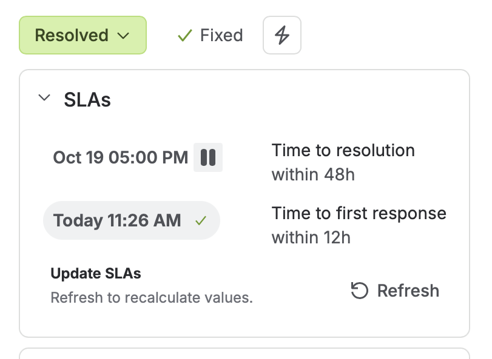

# Case 2: Work Account Lockout After a Password Change

**Ticket:** IT-2
**Platform:** Jira Service Management
**Status:** Resolved
**Resolution:** Fixed

## Overview

Alex Ross, a fictional Sales employee, reported being unable to sign in to his Windows work laptop, preventing access to email and sales documents.

I managed the ticket in Jira using separate customer and agent accounts. Identity verification, account checks, and the account unlock were simulated.

## Investigation

I asked where Alex was attempting to sign in, what error appeared, and when access last worked.

Alex reported:
- Windows displayed: “The referenced account is currently locked out and may not be logged on to.”
- His last successful sign-in was the previous afternoon.
- He had changed his password before leaving work.
- He repeatedly entered his old password the following morning.
- He remembered his new password.

The reported attempts with the old password were the likely cause of the lockout.

## Identity Verification and Authorization

Before the simulated account change, I documented identity verification through a simulated callback to the number recorded in the fictional employee directory, following the lab’s approved procedure.

Simulated checks confirmed that:
- The account was locked but otherwise enabled.
- The helpdesk role was authorized to unlock it.

No passwords or MFA codes were requested or recorded.

## Resolution Decision

I initially considered both unlocking the account and resetting the password. After reviewing the evidence, I chose an unlock alone because Alex remembered his new password.

This exercise reinforced the distinction:
- Unlocking removes the account lockout.
- Resetting changes the password.

## Simulated Action and Verification

After the simulated unlock, I asked Alex to try signing in once with his new password and stop retrying if an error appeared.

Alex confirmed:
- Successful sign-in.
- Access to email and sales documents.
- No further errors.

I recorded the outcome in an internal note, sent a closing reply, and marked the ticket Resolved with resolution Fixed.

## Lessons Learned

- Identify the exact error before choosing a corrective action.
- Verify identity and authorization before making account changes.
- Avoid unnecessary password resets.
- Keep internal technical notes separate from customer replies.
- Obtain confirmation that the affected services work before resolving a ticket.

## Lab Scope

Ticket assignment, comments, internal notes, and resolution were performed in Jira. Separate accounts represented Alex and Charlie.

The Windows account, identity-verification call, account checks, unlock, and sign-in results were simulated. No Windows or Active Directory account was actually modified.

## Screenshots

### Original request

### Investigation

### Simulated verification and planned action

### Customer confirmation and closure notes

### Resolved ticket

