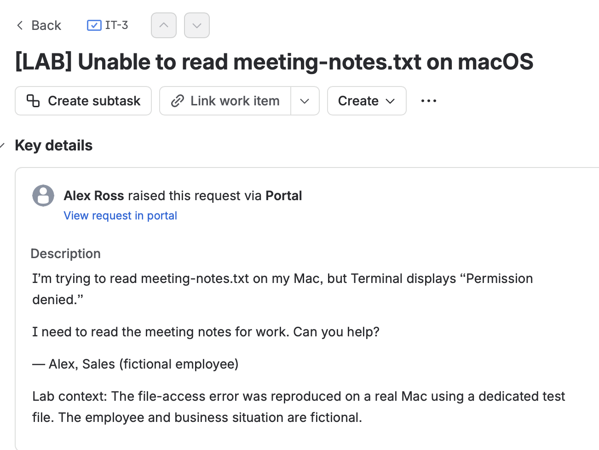
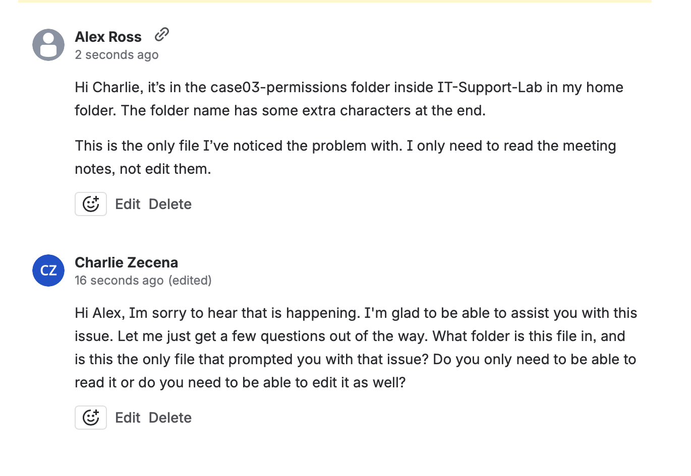
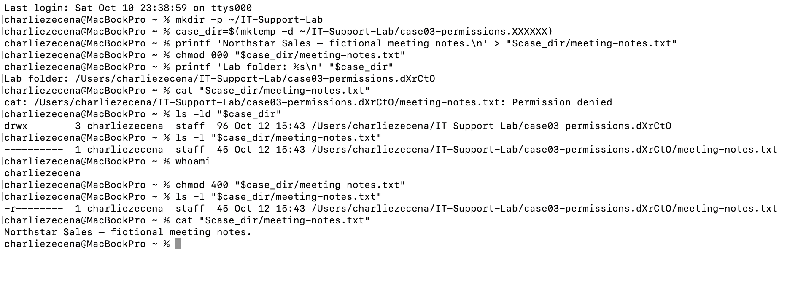
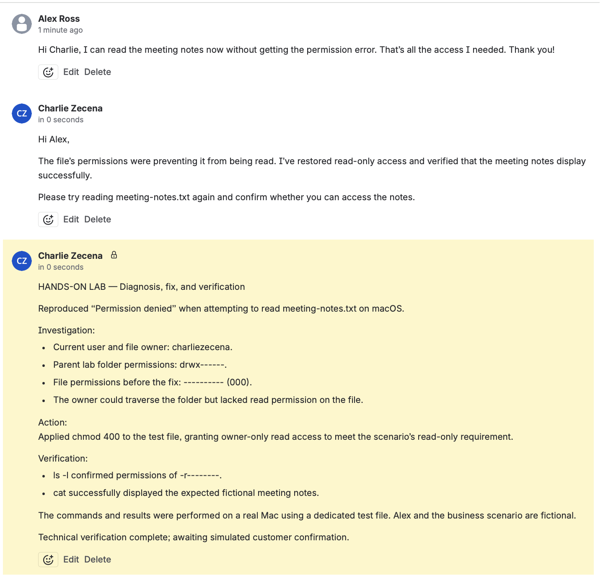
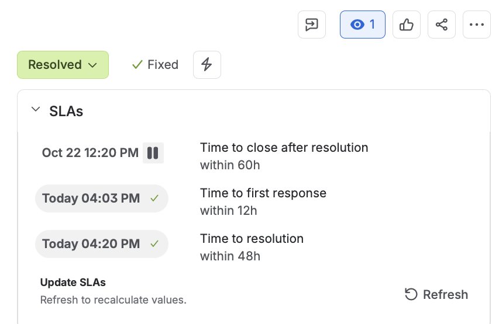

# Case 3: Unable to Read a File on macOS

## Lab Scope
The troubleshooting commands, permission changes, and verification were performed on my Mac using a dedicated test file. Alex and the business scenario are fictional, and customer communication was role-played in Jira Service Management.

The operating-system tests used my local account, `charliezecena`. Alex was the fictional Jira customer, not a separate macOS user.

## Reported Issue
Alex reported receiving “Permission denied” when attempting to read `meeting-notes.txt` in Terminal.

## Initial Investigation
I asked:
- Where is the file located?
- Is this the only affected file?
- Do you need read-only access or permission to edit?

Alex confirmed that only this file was affected and that read-only access was sufficient.

## Troubleshooting
In the existing Terminal session, `$case_dir` referred to the dedicated folder created for this lab.

I checked the current user, folder permissions, and file permissions:

```bash
whoami
ls -ld "$case_dir"
ls -l "$case_dir/meeting-notes.txt"
```

Findings:
- The current user and file owner were `charliezecena`.
- The folder permissions were `drwx------` (700), allowing the owner to access and traverse the folder.
- The file permissions were `----------` (000), granting no read, write, or execute permissions to the owner, group, or others.
- Attempting to read the file with `cat` produced “Permission denied.”

## Root Cause
The test file’s permissions had deliberately been set to 000 to reproduce the issue. The owner could access the folder but lacked permission to read the file.

## Resolution
I granted read-only access to the file owner:

```bash
chmod 400 "$case_dir/meeting-notes.txt"
```

This met the requested access level without granting write or execute permissions, or access to the group or others.

## Verification
I checked the updated permissions and attempted to read the file again:

```bash
ls -l "$case_dir/meeting-notes.txt"
cat "$case_dir/meeting-notes.txt"
```

Results:
- File permissions changed to `-r--------` (400).
- `cat` successfully displayed:

```text
Northstar Sales — fictional meeting notes.
```

- The permission error no longer occurred.

## Customer Communication
I documented the diagnosis, permission change, and verification in an internal Jira note. I explained the fix to the fictional customer and requested confirmation that the notes could be read.

## Skills Demonstrated
- Clarifying the scope of a reported issue
- Distinguishing folder permissions from file permissions
- Inspecting ownership and permissions with `whoami` and `ls`
- Applying least privilege with `chmod`
- Verifying access with `cat`
- Documenting technical findings and communicating with a customer

## Screenshots

### Initial Request


### Investigation


### Terminal Evidence


### Internal Notes


### Customer Confirmation and Resolution

